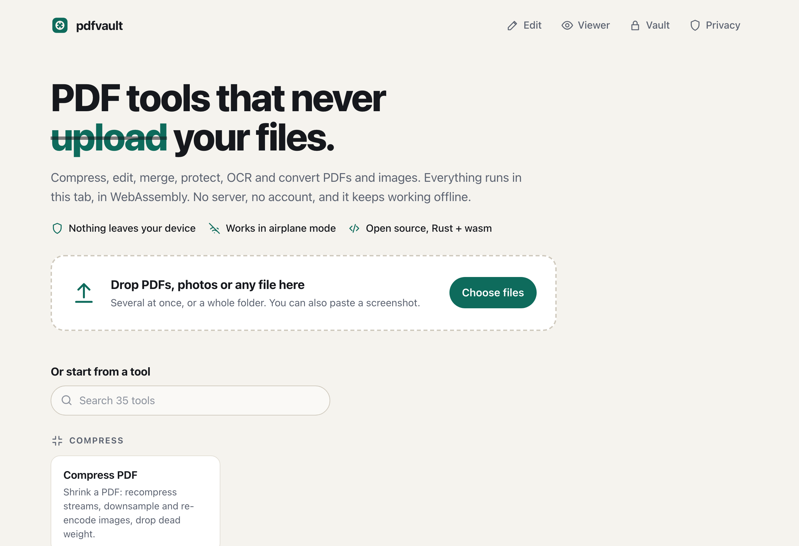
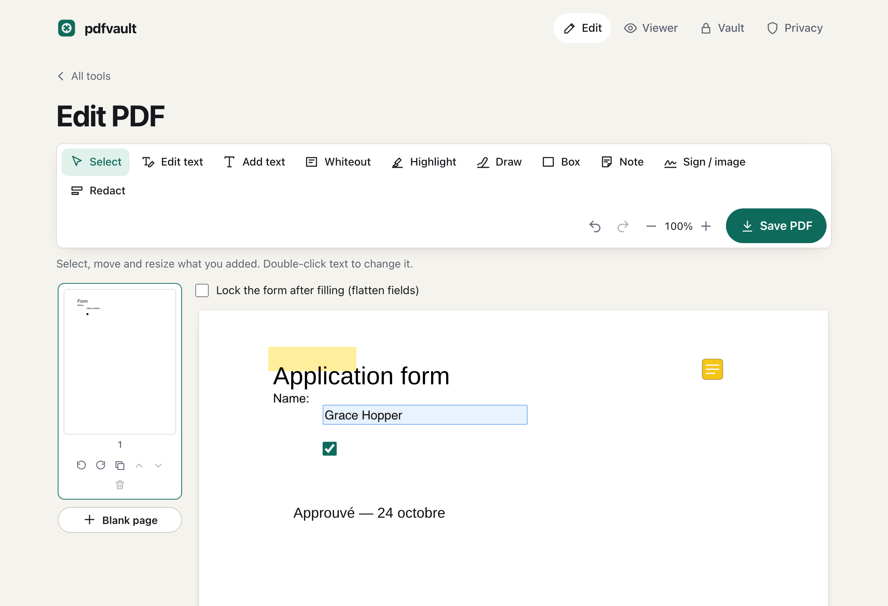
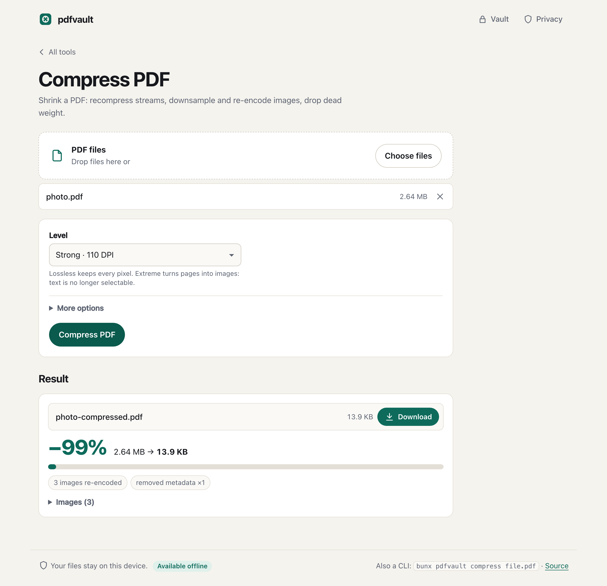

# pdfvault

**Private PDF and image tools that never upload your files.** Drop your PDFs and photos, then compress, edit, sign, fill, redact, merge, split, protect, OCR or convert them, entirely on your device. One Rust engine compiled to WebAssembly runs both the website and the command-line tool, so they always produce the same bytes.

**→ [maxgfr.github.io/pdfvault](https://maxgfr.github.io/pdfvault/)** · works offline after the first visit · `bunx pdfvault --help`

[](https://github.com/maxgfr/pdfvault/actions/workflows/ci.yml)
[](https://github.com/maxgfr/pdfvault/releases)

<picture>
  <source media="(prefers-color-scheme: dark)" srcset="docs/home-dark.png">
  
</picture>

## Why

Online PDF tools ask you to upload contracts, payslips and scans to someone else's server. pdfvault does the same work in your browser tab, in WebAssembly, and the browser itself is told to forbid any connection to another origin. There is no backend, account, analytics or third-party script.

## How it works

Start from your files, not from a tool. Drop several PDFs, photos or a whole folder on the home page (or paste a screenshot): the page lists them with a preview (click it to read the PDF page by page) and offers what fits the selection. Compress works on a mix (each file gets the right tool), photos and PDFs combine into one PDF in the order shown, and every tool that accepts the selection is one click away. A result can replace its original in the list, so you can compress, then protect, then download, without saving anything in between. Formats the browser cannot read (HEIC, Office documents) are named with what to do instead.

The editor opens a PDF page by page. **Edit text**: click a line of the document's own text and change it; the old glyphs are taken out of the page and the new text is written in the same font. A PDF usually embeds only the characters it uses: when a new character is missing (a digit in a date or an amount), the line is redrawn with the complete font installed on your device (the browser asks once for access to local fonts; the CLI looks in the system font folders), or else only that character takes the closest Liberation font (metric-compatible with Arial, Times New Roman and Courier New). Add text in any script (shaped with HarfRust, right-to-left included; for scripts the bundled fonts lack, the editor uses a font from your device or one you pick). Whiteout, boxes, freehand drawing, a drawn or imported signature, images, highlights and sticky notes (real annotations other PDF apps can edit), form filling, and reorder, rotate, duplicate, delete or insert pages from the page strip. **Redaction** removes what lies under each box from the file itself (glyphs, image pixels, shapes, annotations and form fields over it) and leaves the rest of the page as it was, text included; a second, independent reading of each redacted page (hayro) turns any page it doubts into an image. Undo and redo cover every step. Saving runs the same `edit` command the CLI has.

<picture>
  <source media="(prefers-color-scheme: dark)" srcset="docs/editor-dark.png">
  
</picture>

## Tools

| Category | Tools |
| --- | --- |
| Compress | **Compress PDF** with four levels (below), never larger than the original |
| Organize | Merge (one bookmark per file), combine PDFs and images into one PDF, split (ranges, every N pages, by bookmark), extract, delete, reorder, rotate, insert blank pages, N-up (2–16 pages per sheet) |
| Edit | **Editor**: change existing text, add text in any script, whiteout, shapes, drawing, signature and images, highlights and notes as annotations, form filling, true redaction that keeps the rest of the page selectable, page strip. **Viewer**. Crop, text watermark, page numbers, header and footer, visual signature (image stamp), metadata (read, edit, wipe), flatten forms, repair, compare (pixel diff per page), info |
| Security | Password protection with **AES-256** (PDF 2.0, revision 6), permissions, unlock |
| Convert | Images → PDF (JPEGs embedded untouched, EXIF orientation honored), PDF → PNG/JPEG/WebP, **OCR → searchable PDF**, PDF → Markdown, text or EPUB (OCR on scanned pages) |
| Images | Compress, resize, convert JPEG/PNG/WebP, strip EXIF/GPS/XMP without re-encoding, crop/rotate/flip, in batches |

### Compression levels

| Level | What it does | Use it for |
| --- | --- | --- |
| `lossless` | Rewrites into object streams, recompresses every Flate stream at the maximum level, merges identical objects and images, drops thumbnails, metadata, XMP and JavaScript | Text, slides, vector diagrams |
| `balanced` | Plus images downsampled to 150 DPI of their real size on the page; photos to JPEG q80, flat-color art kept lossless (indexed palette) | Most documents |
| `strong` | 110 DPI, JPEG q65 | Photo-heavy files, phone scans |
| `extreme` | Every page rendered to one JPEG | Scans nothing else shrinks; text stops being selectable |

Advanced settings override the level: target DPI, JPEG quality, grayscale, keep metadata, remove attachments. An image is only replaced when the new encoding is smaller, and when the whole result is not smaller the original comes back unchanged. The report lists every image with its effective DPI and size before and after.

<picture>
  <source media="(prefers-color-scheme: dark)" srcset="docs/compress-dark.png">
  
</picture>

## Command line

```sh
bunx pdfvault compress report.pdf --preset strong          # → report-compressed.pdf
bunx pdfvault compress "scans/*.pdf" -o small/ --json      # batch, machine-readable report
bunx pdfvault merge a.pdf b.pdf -o all.pdf
bunx pdfvault combine scan.pdf photo.jpg -o all.pdf             # PDFs and images, in order
bunx pdfvault edit form.pdf sig.png --ops @edits.json            # the editor's JSON, see the skill
bunx pdfvault split book.pdf --mode bookmarks -o chapters/
bunx pdfvault encrypt contract.pdf --user-password '…'
bunx pdfvault ocr scan.pdf && bunx pdfvault to-md scan-searchable.pdf
cat in.pdf | bunx pdfvault extract - --pages 2-4 -o - > part.pdf
bunx pdfvault img strip "photos/*.jpg" -o clean/
```

Standalone binaries (macOS, Linux, Windows × arm64, x64, with the OCR models embedded; `brew install maxgfr/tap/pdfvault` on macOS and Linux) are on the [releases page](https://github.com/maxgfr/pdfvault/releases) with a `SHA256SUMS` file and provenance attestations (`gh attestation verify pdfvault-macos-arm64 -R maxgfr/pdfvault`).

- Every command accepts globs, `-` for stdin, `-o -` for stdout, `-o dir/` for several outputs.
- `--json` prints `{ command, ok, results: [{ input, ok, outputs, report | error }] }`. Error `code`s are stable: `invalid_pdf`, `password_required`, `wrong_password`, `limit`, `invalid_option`, `unsupported`, `image`.
- Exit codes: `0` success, `1` a file failed (the others still ran), `2` usage error.
- The input is never overwritten; existing outputs only with `--force`.
- `pdfvault <command> --help` lists each command's flags; `pdfvault list` prints all commands as JSON.

## Agent skill

`skills/pdfvault/SKILL.md` teaches a coding agent to use the CLI: which level for which content, how to read the `--json` report and climb levels until a target size is met, and the limits. Install it into any agent (Claude Code, Codex, OpenCode, Cursor…) with [skills](https://github.com/vercel-labs/skills):

```sh
npx skills add maxgfr/pdfvault             # pick the agents interactively
npx skills add maxgfr/pdfvault -a codex    # or name them
```

`pdfvault skill` prints the copy that ships inside the CLI, so an agent can also read the instructions that match the installed version directly.

## How privacy is enforced

- **No network after load.** A Content Security Policy in a `<meta>` tag (GitHub Pages cannot send headers): `default-src 'self'; script-src 'self' 'wasm-unsafe-eval'; connect-src 'self'; img-src 'self' blob: data:; worker-src 'self'; object-src 'none'; base-uri 'none'; form-action 'none'; require-trusted-types-for 'script'`, plus `referrer: no-referrer`. Trusted Types only vouch for the app's own worker and service worker. Fonts, icons and scripts all ship from this repository.
- **Checked in CI.** `scripts/check-no-network.ts` fails the build if the bundle contains an external URL that is not allowlisted with a reason, a network call to a literal URL, or a wasm module importing a network API. Playwright asserts zero cross-origin requests and zero CSP violations while every tool runs.
- **Offline.** A service worker caches the app shell on first visit; the renderer and OCR models are cached the first time a tool needs them. The test suite runs tools in airplane mode.
- **Memory.** Each job runs in its own Web Worker, terminated when the job ends, which frees all wasm memory. Inputs are size- and page-limited, and jobs time out.
- **Encrypted vault (optional, off by default).** Keep files in IndexedDB, sealed with AES-256-GCM under a key derived from your passphrase with Argon2id (64 MiB, 3 passes) in the Rust engine and imported into WebCrypto as non-extractable. File names are encrypted too. It locks after 5 minutes idle or when the tab is hidden, and has an emergency wipe. Without it, nothing is stored.
- **Verifiable builds.** The site is built and tested by GitHub Actions and deployed with a build provenance attestation (`gh attestation verify index.html -R maxgfr/pdfvault` on a downloaded file). Actions are pinned by commit SHA; `cargo deny`, `osv-scanner` and a fuzzing run of the PDF parser gate every push. Frames are refused by a script guard, since `frame-ancestors` needs a header.

## Architecture

```
crates/
  core/      lopdf, image, jpeg-encoder, miniz_oxide, argon2: every PDF and image operation;
             a content-stream interpreter for editing text and redacting, HarfRust + subsetter for writing it
  render/    hayro: rasterizing, positioned text, visual diff, the extreme level   (loaded on demand)
  ocr/       ocrs + rten: Latin-script OCR                                        (loaded on demand)
  wasm-*/    wasm-bindgen façades, one uniform run(op, inputs, options) each
  fixtures/  writes the generated test documents
packages/
  engine/    TypeScript API over the three wasm modules + the tool registry
  cli/       the pdfvault command (Bun), compiled per platform with bun build --compile
  web/       React 19 site bundled with Bun, Web Worker, service worker, vault
skills/pdfvault/  the agent skill
e2e/         Playwright: every tool, security, offline, CLI ↔ browser parity, vault
```

The tool registry (`packages/engine/src/tools.ts`) declares every tool once; the CLI's commands and flags and the site's forms are generated from it, so both run the same code on the same wasm. A parity test hashes the outputs of the CLI and the browser for the same input.

## Development

Requirements: Rust (pinned in `rust-toolchain.toml`, with the `wasm32-unknown-unknown` target), [wasm-pack](https://github.com/drager/wasm-pack) 0.15, [Bun](https://bun.sh) 1.2+, and `qpdf` (every PDF the Rust tests write must pass `qpdf --check`).

```sh
bun install
bun run fetch-models     # ocrs models and Liberation fonts, pinned by SHA-256
bun run build:wasm       # crates → packages/engine/wasm
bun run fixtures         # generated test PDFs and images (no third-party binaries)
cargo test --workspace   # Rust, incl. qpdf --check on outputs and OCR
bun run test             # engine, CLI, vault crypto, no-network checker
bun run dev              # site at http://localhost:4173/pdfvault/
bun run e2e              # Playwright
bun run build:binaries macos-arm64   # standalone executable(s)
```

Fuzzing: `cd fuzz && cargo +nightly fuzz run parse`.

## Limits

- OCR reads Latin script only.
- `extreme` turns text into pixels; run OCR on the result if it must stay searchable.
- Fonts are not subset, so text-only PDFs shrink less than image-heavy ones.
- The visual signature is an image, not a cryptographic signature.
- Existing text is edited line by line, without reflowing a paragraph; a longer line runs further right. Lines in vertical writing or at an angle are not offered.
- When a changed line needs a character its embedded font lacks and the complete font is not installed (or, in the browser, Local Font Access is unavailable or refused), that character comes from Liberation Sans, Serif or Mono, close to but not the same as fonts other than Arial, Times and Courier.
- Redaction turns a page into an image only when it cannot be sure (an image it cannot repaint, a font whose glyph positions are guessed); shapes crossing a box edge stay, hidden under it.
- HEIC and AVIF photos and Office documents cannot be read; export them as JPEG or PDF first.
- WebP output is lossless (no lossy WebP encoder in pure Rust).
- No threads in wasm: GitHub Pages cannot send the COOP/COEP headers they need.

## Credits

Built on [lopdf](https://github.com/J-F-Liu/lopdf), [hayro](https://github.com/LaurenzV/hayro), [ocrs](https://github.com/robertknight/ocrs) and [rten](https://github.com/robertknight/rten), [image](https://github.com/image-rs/image), [jpeg-encoder](https://github.com/vstroebel/jpeg-encoder), [miniz_oxide](https://github.com/Frommi/miniz_oxide) and [RustCrypto argon2](https://github.com/RustCrypto/password-hashes), [HarfRust](https://github.com/harfbuzz/harfrust), [skrifa](https://github.com/googlefonts/fontations), [subsetter](https://github.com/typst/subsetter) and [unicode-bidi](https://github.com/servo/unicode-bidi). The editor writes text with the [Liberation fonts](https://github.com/liberationfonts/liberation-fonts) (SIL Open Font License 1.1). The OCR models are © Robert Knight, [ocrs-models](https://github.com/robertknight/ocrs-models), licensed CC-BY-SA 4.0. This software is based in part on the work of the Independent JPEG Group. Inspired by [PDFCraft](https://github.com/PDFCraftTool/pdfcraft) and [pdf-craft](https://github.com/oomol-lab/pdf-craft).

## License

[MIT](LICENSE)
